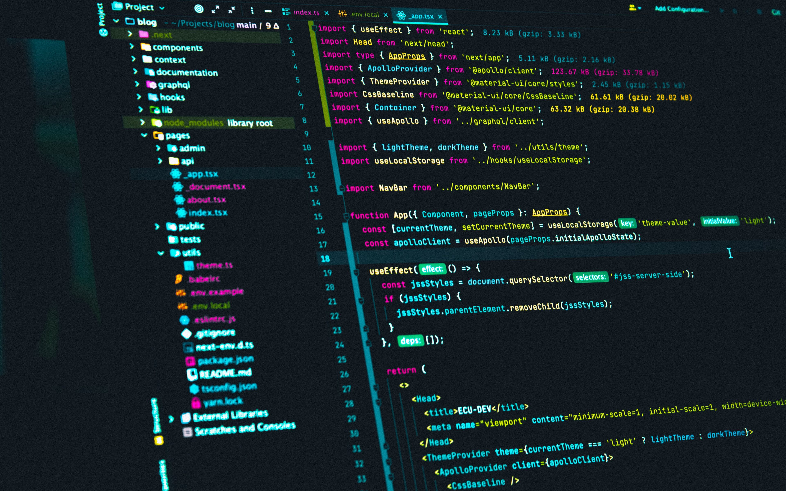

  

 

  <h1>Hi there, I'm Rabah Bedirina</h1>
  <h3>Instrumentation & Control System Engineer | Open-Source Enthusiast</h3>
  
<em>From Algeria - Bridging the physical world of industrial systems with the digital universe of code.</em>

  

    I learned a huge amount from the open-source community. I truly believe that collaboration, 
    curiosity, and knowledge sharing are the driving forces behind great engineering.
  

 

  

 

   
  

 

  

